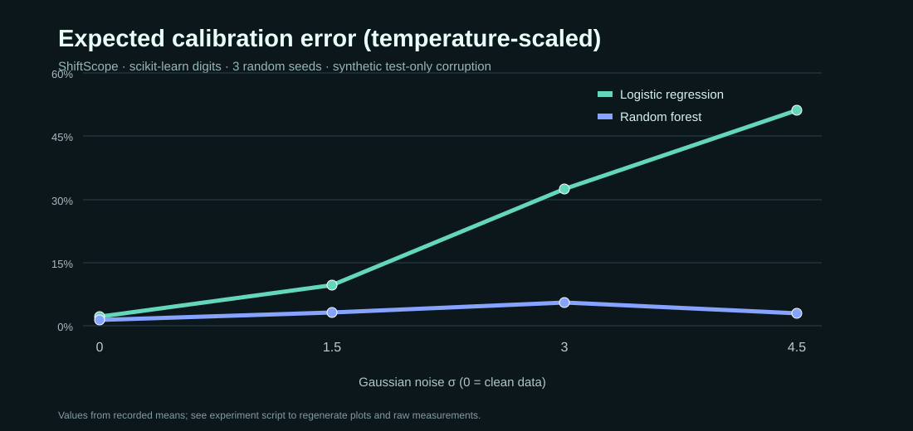
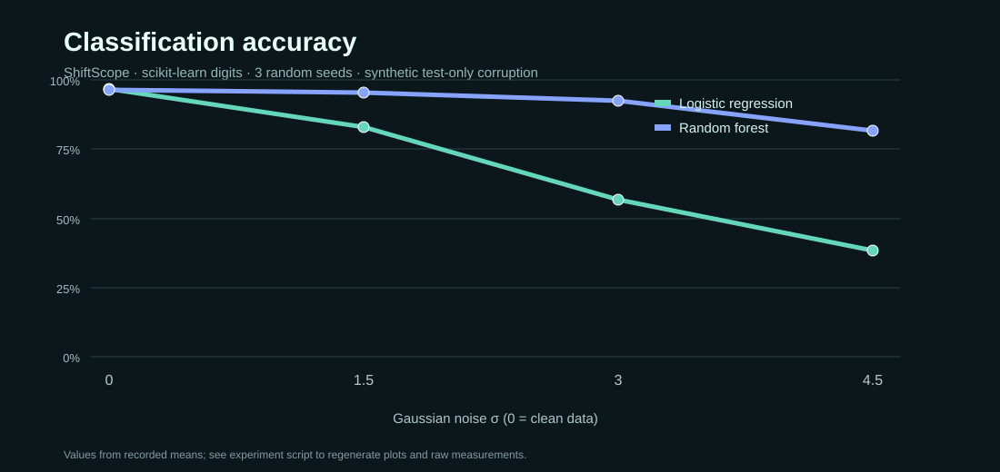
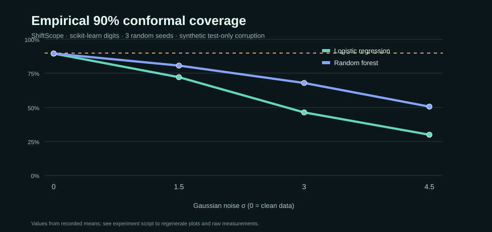
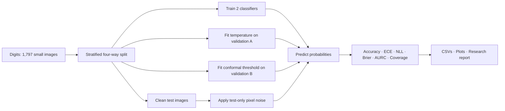

# ShiftScope

### What happens to a model's confidence when the input data changes?

**A small, reproducible ML research project about calibration, distribution shift, and uncertainty.**



I built ShiftScope around a simple question: **when a classifier becomes less accurate, does its confidence fall too?** A model that is confidently wrong is harder to trust than one that knows when it is uncertain.

Rather than training a large neural network, this project uses two lightweight baselines on handwritten digits. It gradually adds noise to *test images only*, keeps the training and calibration data clean, and measures whether confidence and uncertainty estimates remain useful. Everything runs on a laptop CPU without PyTorch, a GPU, paid APIs, or a data download.

## What I tested

- **Two classifiers:** logistic regression and random forest.
- **Four conditions:** clean inputs and three levels of Gaussian pixel noise.
- **Probability calibration:** compare raw probabilities with a temperature fitted on a separate validation split.
- **Selective prediction:** measure how error changes when keeping only high-confidence predictions (AURC).
- **Conformal prediction:** evaluate empirical coverage and the size of prediction sets targeting 90% coverage on clean calibration data.
- **Three random seeds:** publish raw per-seed measurements, means, and sample standard deviations instead of a single lucky run.

**Read the [research design](RESEARCH.md) and [actual results](results/report.md).** The reported measurements come from a completed three-seed run. The SVG previews below are drawn from its recorded averages; the experiment script regenerates the raw CSVs and detailed PNG plots.

### What the first experiment showed

The two classifiers started at roughly 96% accuracy on clean digits, but their behavior changed a lot under strong noise. Averaged across three seeds, logistic regression fell to **38.4% accuracy**, while random forest retained **81.5%**. The prediction sets targeting 90% clean-data conformal coverage dropped to **29.9%** and **50.6%** observed coverage, respectively, when test-image noise reached σ=4.5.

That gap is the part I found most interesting. It's easy to report clean accuracy and assume the system is reliable. This experiment shows why I'd also check what happens to confidence, calibration, and the ability to communicate uncertainty after the input distribution changes. These are results from small, synthetic tests—not a guarantee about which model would do better elsewhere.

## A few charts from the study

| Classification accuracy | Conformal coverage |
|---|---|
|  |  |

See [the full report](results/report.md) for model-by-model values, confidence metrics, and limitations.

## How the experiment works



**Important:** conformal prediction's standard marginal coverage guarantee relies on the calibration and test data being exchangeable. Deliberately corrupting only test images violates that assumption. The goal here is to *measure* what happens, not claim that any coverage guarantee survives the shift.

## Run it yourself

Requires Python 3.11+.

```bash
python -m venv .venv
# macOS/Linux: source .venv/bin/activate
# Windows PowerShell: .venv\Scripts\Activate.ps1
python -m pip install -r requirements.txt
python -m pytest -q
python -m shiftscope
```

All results are written to `results/`. You can run one seed for a quick check:

```bash
python -m shiftscope --seeds 7 --output quick-results
```

No cloud service, OpenAI key, or GPU is required. CI runs the tests and regenerates the study on GitHub-hosted CPU runners.

## Project structure

```text
shiftscope/
  experiment.py       train, split and corrupt test images
  metrics.py          calibration, selective-risk and conformal metrics
  reporting.py        write actual CSVs, plots and report
  __main__.py         one-command experiment runner
tests/                 metric unit tests + short end-to-end checks
results/               reproducible numbers, plots and findings
RESEARCH.md            hypotheses, protocol, assumptions and caveats
.github/workflows/    CPU-only verification
```

## What it proves—and what it doesn't

This project shows that I can frame an ML question, build reasonable baselines, keep training and evaluation separate, run controlled experiments, and document failures and limitations. **It is not a new research algorithm or a published benchmark.** The digits dataset is intentionally small; noisy 8×8 digits are not a realistic substitute for every type of deployment shift. Mean ± standard deviation across three seeds is not a confidence interval.

If I expanded this into a larger study, the next steps would be a real-world corruption dataset, a pre-registered protocol, more seeds, and confidence intervals on model comparisons. I kept this version small enough for anyone to reproduce in a few commands.
