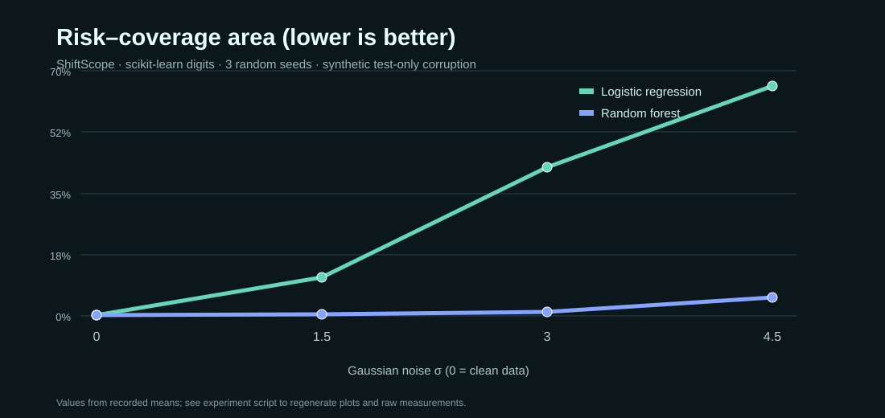

# ShiftScope: recorded three-seed results

This table summarizes the experiment run on the built-in 1,797-image scikit-learn digits dataset. Training and calibration images are clean; Gaussian noise is applied only to test images. Values are means over random seeds 7, 21, and 42.

| Model | Noise σ | Accuracy | Temp.-scaled ECE | Observed conformal coverage |
|---|---:|---:|---:|---:|
| Logistic regression | 0.0 | 96.6% | 2.2% | 89.4% |
| Logistic regression | 1.5 | 83.0% | 9.7% | 72.0% |
| Logistic regression | 3.0 | 56.7% | 32.4% | 46.1% |
| Logistic regression | 4.5 | 38.4% | 51.1% | 29.9% |
| Random forest | 0.0 | 96.4% | 1.4% | 89.4% |
| Random forest | 1.5 | 95.3% | 3.1% | 80.6% |
| Random forest | 3.0 | 92.4% | 5.6% | 67.8% |
| Random forest | 4.5 | 81.5% | 2.9% | 50.6% |

## Figures

## Interpretation

The classifiers respond differently under severe image corruption. The 90% conformal target is a *clean-data*, exchangeability-dependent property; corrupting only the test distribution invalidates that assumption. This is an illustrative synthetic study and should not be interpreted as a new theoretical result or as an estimate of performance on real-world distribution shift. Run `python -m shiftscope` to regenerate raw CSVs, detailed summaries and high-resolution PNG charts.
